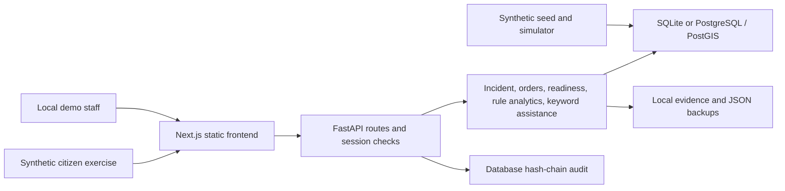

# Coastal security architecture

The current ICCC POC is a single application with synthetic data. Preserve its working capabilities while developing tested interfaces incrementally. The research demo, this application and the Lovable coastal dashboard remain separate systems.

## Current implementation

Source paths: `frontend/`, `backend/app/routers/`, `backend/app/services/`, `backend/app/models.py`, `backend/app/audit.py`, `seed/`, `docker-compose.yml`. Static frontend files are served by FastAPI; the simulator and in-memory rate limiter assume a single process. MapLibre uses public raster/seamark tiles with an approximate offline fallback.

Readiness is computed from personnel, crew, maintenance and asset records. Resource ranking uses heuristic suitability, distance and estimated travel time. Vessel rules produce cues for human verification. The language engine uses keywords/templates and preserves original text; voice uploads are not transcribed. None of these components establishes validated ML performance.

Role/capability and jurisdiction helpers exist, but object enforcement is inconsistent. The field-order path confirms dispatch at EN_ROUTE; the manual incident C5 path has a weaker check. These are [review blockers](REVIEW_FINDINGS.md), not architecture guarantees.

## Target modules and boundaries

| Module | Current foundation | Proposed next boundary |
| --- | --- | --- |
| Ingestion and validation | Synthetic seed/simulator; root synthetic incident contract | Versioned approved adapters, registry membership, provenance, schema quarantine and deduplication |
| Maritime monitoring | Synthetic tracks and heuristic alerts | Time/entity-aware replay and detector evaluation, bounded track queries, reviewed alerts |
| Geospatial awareness | MapLibre, PostGIS views, schematic fallback | Spatial indexes, bounding-box/time filters, coordinate quality, licensed layers, last-known/stale display |
| Vision analytics | UAV resources; separate label/confidence research | Approved imagery provenance, CV inference service and image-level held-out evaluation |
| Security events | Login/session/audit event views | Structured collection, rules and SOC export with retention/access controls |
| Human decision support | Rule recommendations, draft AAR and keyword assistance | Evidence-linked model suggestions, uncertainty, human approval and safe refusal on insufficient evidence |
| Training and model lifecycle | Root reproducible synthetic vessel benchmark | Dataset/model cards, immutable experiment versions, approval before promotion, drift and false-alert monitoring |
| Identity and audit | JWT/server sessions, role matrix, partial jurisdiction checks | Centralized object policy, federated identity, safe MFA lifecycle, external audit anchoring |
| APIs and deployment | FastAPI/static frontend and Compose | Versioned contracts, idempotent commands, observability, isolated environments and tested recovery |
| Tests and CI | pytest/Playwright; repository baseline CI | Exact-revision ICCC jobs, negative permission tests, contract tests and release evidence |

## Proposed interaction model

Adapters validate schema, provenance, timestamps and jurisdiction before records enter a review queue. Rejected records retain a reason in a restricted quarantine, never a silently corrected operational value. Human reviewers confirm an incident; an authorized officer issues a task; the responsible field user acknowledges and confirms execution. Recommendations remain evidence attached to decisions.

Preserve the citizen-selected destination when forwarding a report. A forward is a separate attributed record with source/destination and acknowledgement, not a mutation of ownership. The root incident contract demonstrates this invariant using synthetic data only; application ingestion and cross-state authorization remain future work.

The Lovable concepts are mapped in [the repository bridge document](../../docs/LOVABLE_CONCEPT_MAPPING.md). There is no shared database, synchronization, credential exchange or deployed API integration.

## Scale and failure design

Start with a tested modular application. Add workers/queues only when load and failure measurements justify them. EventFeed rows are not a durable message bus: reliable publication needs an outbox or equivalent atomic delivery strategy, idempotency, retry limits, dead-letter handling and monitoring.

Multiple replicas require simulator leadership or external ingestion, shared rate limiting, concurrency-safe commands, shared evidence storage and correct session/authorization behavior. PostgreSQL HA, object storage, queues and orchestration are proposed deployment components, not an existing national-scale system.

Before a pilot, define dataset size, simultaneous users, request/ingest rates, retention, latency/error targets, failover objectives and tenant-isolation tests. Agree numeric targets with owners, then measure them. Use [ROADMAP.md](ROADMAP.md) gates rather than calendar promises.

## Data and model controls

Record source owner, license/approval, source time, received time, coordinate quality, schema version and verification state. Retain original messages alongside interpretations. Do not treat simulated risk scores as calibrated probabilities or estimated coordinates as verified observations.

Evaluate vessel rules and learned models separately. Split by time and entity; fit preprocessing on training only; select thresholds on validation only; keep test data frozen. Report precision, recall, false alerts, missed incidents, class support, calibration where relevant and analyst workload. CV needs image/video splits without scene leakage; cybersecurity needs independent labeled event windows. Existing synthetic results cannot validate any real deployment.
