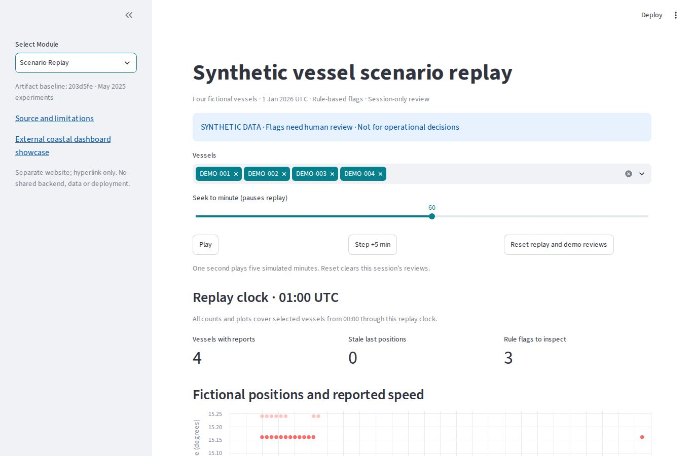

# Coastal Analytics Research Demo

A Python and Streamlit research demonstrator for **synthetic coastal analytics**: preserved vessel, drone and cybersecurity experiments, plus an interactive vessel replay and human review exercise.

**Status: experimental. Not validated for operational decisions or production use.** Three views display saved CSVs and PNGs. The additional Scenario Replay generates fictional timestamped tracks, explains rule flags and records session-only demo reviews. No live feeds, model inference or operational actions are connected.

[Streamlit research demo](https://ai-coastal-security-defense.streamlit.app/) · [Command-centre concept (Lovable)](https://icccodishacshq.lovable.app/) · [Installation](docs/INSTALLATION.md) · [Architecture](docs/ARCHITECTURE.md) · [Limitations](docs/LIMITATIONS.md) · [Security](SECURITY.md)

The hosted demo may sleep. This repository does not establish which revision is currently deployed.

## Related command-centre dashboard

**[Explore the coastal command-centre concept built with Lovable](https://icccodishacshq.lovable.app/)**

This separate prototype explores citizen reporting, jurisdiction-based staff views, geospatial situational awareness and AI-assisted briefings with human review. The long-term ambition is a national, state, district and station hierarchy. National-scale capacity, operational readiness and official endorsement have not been established by this repository.

The public landing and reporting pages can be viewed without an account; staff views require authorised access. The linked site's reporting forms are not a sandbox verified by this repository. Use the link for interface review only: do not submit real incidents, personal details or restricted information during a demonstration.

The Lovable application is hosted and maintained separately. Its **only relationship to this project is the external showcase hyperlink**. This repository does not develop, connect, synchronise, deploy or share data/backends with that website. See the [project boundary](docs/ARCHITECTURE.md#related-lovable-prototype).

## What exists

| Module | Implemented | Limitations |
| --- | --- | --- |
| Vessel anomalies | Offline Isolation Forest research code and a saved geographic scatterplot | Invalid tuning-label mapping and in-sample evaluation; one observation per vessel, no timestamps or tracking |
| Vessel benchmark | New deterministic synthetic generator, isolated train/validation/test evaluation, saved pipeline and traceable experiment bundle | Speed-only synthetic snapshots; no operational validation or trajectories |
| Drone observations | Offline Random Forest on supplied object labels and confidence scores | No image/video detector; weak saved positive-class results |
| Cybersecurity | Offline Random Forest on dummy packet records | No live monitoring; saved predictions miss all four positive cases |
| Scenario replay | Four fictional tracks, 91 observations, replay controls, freshness, explained rules and human review exercise | Synthetic rules only; session history is not authenticated, persistent or tamper-proof |
| Dashboard | Three preserved research views plus Scenario Replay | Research and workflow demonstration, not an operational system |

LOF, Logistic Regression, SVM, live AIS, autonomous surveillance, and AI-assisted incident analysis are **not implemented in the supported runtime**. Replay uses invented coordinates on local charts, without a navigation basemap. The separate [ICCC platform proposal in PR #10](https://github.com/bikramtheitguy/ai-coastal-security-defense/pull/10) is unmerged work and is not part of this demo.

Read the **[updated Streamlit POC](docs/STREAMLIT_POC.md)**, **[previous/current comparison](docs/STREAMLIT_POC_COMPARISON.md)** and [validation record](docs/STREAMLIT_VALIDATION.md).



Screenshot from the repository's Chromium test environment, using invented data. See the [desktop, narrow-screen and chart comparisons](docs/STREAMLIT_POC_COMPARISON.md#visual-comparison-within-the-replay-increment). This is not evidence of a hosted deployment.

## Run the demo

Use Python **3.13** and [uv](https://docs.astral.sh/uv/getting-started/installation/) **0.13.1**.

```bash
git clone https://github.com/bikramtheitguy/ai-coastal-security-defense.git
cd ai-coastal-security-defense
uv sync --locked --no-dev
uv run --locked --no-dev streamlit run dashboard/app.py
```

Open the local URL printed by Streamlit. No credentials or external data services are required. See the [pip-only instructions](docs/INSTALLATION.md) for Windows and Linux, and the explicit Community Cloud settings.

Select **Scenario Replay** to explore the new POC. Start at minute 45 to see a stale vessel, inspect the flag evidence, and record a fictional review while paused. Downloads include the synthetic observations, provenance manifest and session review history. See the [eight-step walkthrough](docs/STREAMLIT_POC.md#reproduce-and-demonstrate).

Do not activate the committed `venv/` directory. It is a historical Linux/Python environment retained with the original repository; supported installations use a fresh `.venv/`.

## Saved results, recalculated

Class 1 is the positive class. These figures describe the committed prediction files, **not independently reproduced model runs**.

| Experiment | Rows | TP | FP | FN | TN | Precision | Recall | F1 | Accuracy | Always-negative accuracy |
| --- | ---: | ---: | ---: | ---: | ---: | ---: | ---: | ---: | ---: | ---: | ---: |
| Drone | 200 | 2 | 8 | 14 | 176 | 20.0% | 12.5% | 0.154 | 89.0% | 92.0% |
| Cyber | 200 | 0 | 1 | 4 | 195 | 0.0% | 0.0% | 0.000 | 97.5% | 98.0% |

Both saved classifiers fall below an always-negative accuracy baseline. Accuracy alone obscures missed positives. The cyber sample has only four positive cases; these results cannot estimate operational reliability.

The [artifact manifest](dashboard/artifacts.json) records SHA-256 digests of the original CSVs and charts. Tests verify integrity and metric consistency. Original training split IDs, scores, labeling rules, generator code and seeds were not saved. Checksums do not recover that provenance.

## Reproducible vessel benchmark

A separate [vessel-speed benchmark](docs/VESSEL_BENCHMARK.md) now generates documented synthetic observations, fits on training data only, selects a model and threshold using validation data, and evaluates a disjoint test period. It reports false alerts, missed anomalies, ranking metrics and baselines, and records IDs, scores, source hashes and runtime versions.

```bash
uv sync --locked --group research
uv run --locked --group research python -m coastal_security.vessel --output artifacts/vessel-demo
uv run --locked --group research pytest training_tests
```

Use a new output directory for each run. This benchmark does not replace the historical dashboard plot or establish real-world detection quality. Slow ordinary and anomalous scenarios intentionally overlap, illustrating the limits of speed-only detection.

## Repository map

```text
dashboard/               Streamlit viewer, result helpers, saved artifacts and manifest
coastal_security/replay.py Synthetic tracks, transparent rules and review state transitions
coastal_security/vessel/  New synthetic generator, training, evaluation and experiment CLI
data/                    Original datasets described as synthetic
data/replay/              Reproducible fictional vessel observations and provenance manifest
models/                  Original serialized research models; never loaded by the demo
notebooks/               Legacy experiments and notebook outputs; known limitations remain
tests/                   Demo, data-contract, integrity and setup tests
training_tests/          Vessel benchmark isolation, metrics and reproducibility tests
browser_tests/           Isolated Chromium UI tests and hashed test-tool lock
docs/                    Installation, architecture, limitations and provenance
.github/workflows/       Demo/benchmark checks, Chromium QA and dependency auditing
pyproject.toml            Runtime, development and optional research dependency groups
uv.lock                  Universal dependency lock
requirements.txt         Hashed runtime export for pip and Streamlit Community Cloud
requirements-research.txt Hashed optional research export
venv/                    Historical environment; retained, unsupported and unused
```

## Development

```bash
uv sync --locked
uv run --locked ruff check .
uv run --locked ruff format --check .
uv run --locked pytest
```

CI checks the demo and new vessel benchmark on Windows and Linux with Python 3.13, verifies dependency exports, and audits runtime and research dependencies. A separate [Chromium workflow](docs/BROWSER_QA.md) checks the real UI, downloads and narrow layout and retains traces/screenshots. Passing checks establish software behavior on synthetic examples, not operational model validity. See [verification scope](docs/LIMITATIONS.md).

## Next milestones

1. Extend vessel evaluation to approved representative data with predefined acceptance criteria.
2. Add grouped temporal evaluation for vessel trajectories and contextual geospatial features.
3. Introduce reproducible drone/cyber pipelines with documented data provenance and saved preprocessing.
4. Extend the synthetic replay with evaluated geospatial context and approved-source adapters.
5. Evaluate genuine computer vision and event-monitoring pipelines.
6. Introduce evidence-linked AI assistance with human review.

Each milestone needs separate validation. No automatic enforcement or operational decisions are provided.

## License and attribution

Project code is distributed under [MIT](LICENSE). Dataset provenance remains incomplete; the code license is not a substitute for per-asset rights verification. See [data provenance](docs/DATA_PROVENANCE.md) and [third-party notices](THIRD_PARTY_NOTICES.md).
