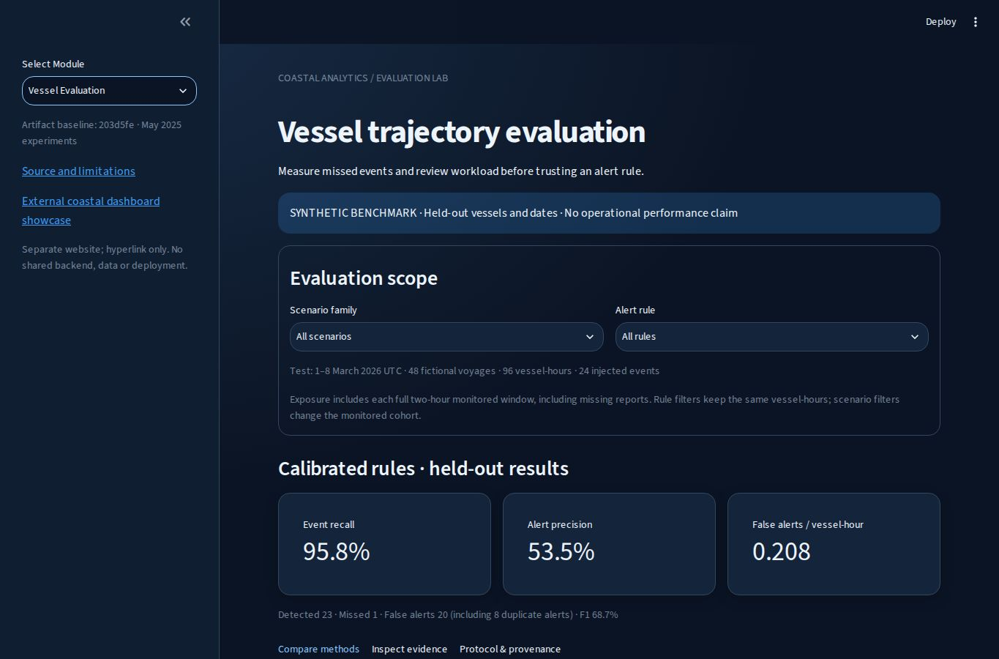
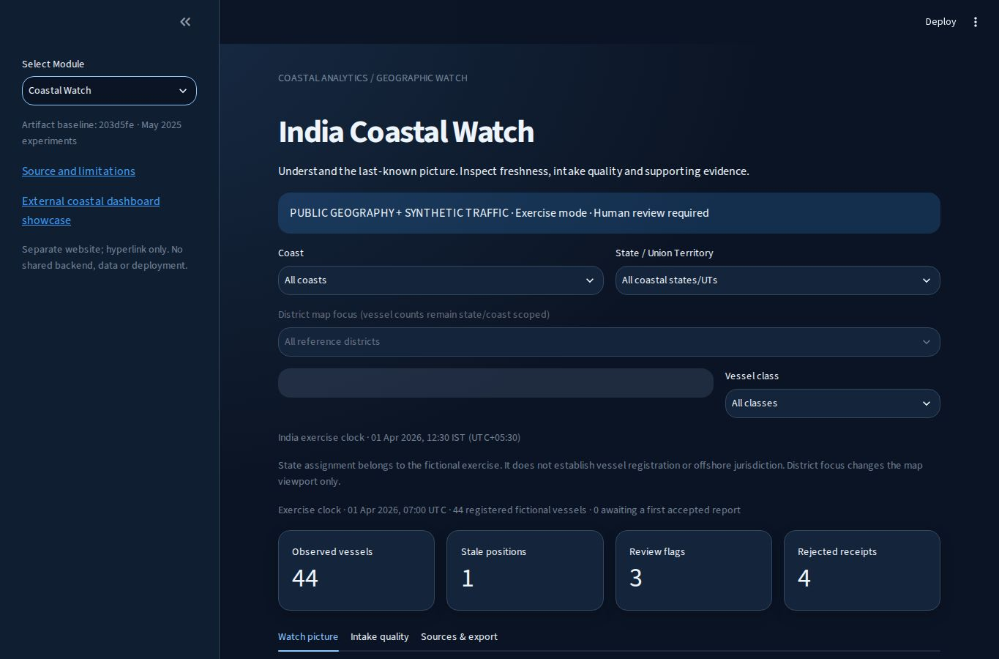
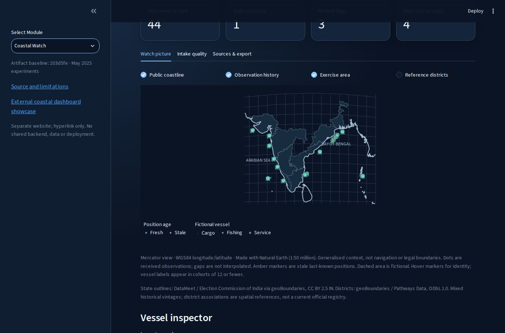
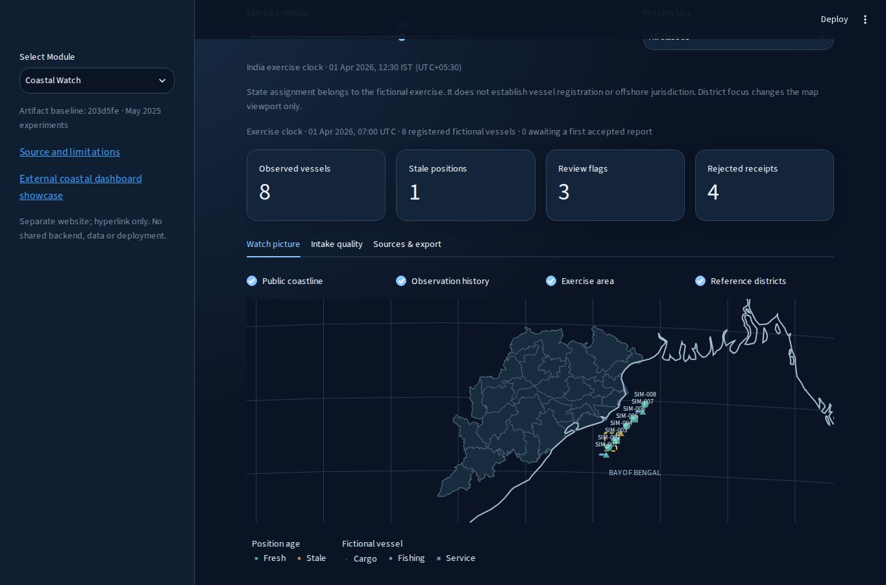
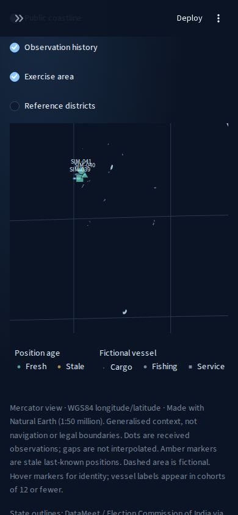

# POC comparison: PR14 baseline and India Coastal Watch

| Capability | PR14 baseline | Current proposed increment |
|---|---|---|
| Research views | Drone, vessel and cyber experiments | Preserved |
| Scenario replay and trajectory evaluation | Synthetic replay and benchmark views | Preserved |
| Geographic context | Schematic synthetic trajectory chart | Public coastline, 13 coastal states/UTs and dated district reference outlines |
| Area selection | Benchmark/replay filters | Coast and state/UT cohort; district map focus |
| Traffic | Synthetic benchmark scenarios | Adds 44 fictional watch vessels across Indian coastal groups |
| Observation handling | Scenario timestamps | Separate observation and receipt times; late/out-of-order evidence retained |
| Data quality | Experiment checks | Duplicate/conflicting/invalid/future payload quarantine and count reconciliation |
| Map semantics | Replay samples | Last-known positions, freshness, observation dots without interpolated outage paths |
| Analyst review | Benchmark evidence | Current rule explanations linked to evidence IDs; snapshot export with integrity hash |
| Provenance | Synthetic benchmark protocol | Pinned public-source hashes, third-party licences, transformations and known gaps |
| Aircraft / context feeds | Not implemented | Planned; not presented as connected or working |
| Production auth / durable cases | Not verified | Still future work; no readiness claim |

## Run and reproduce

Use the existing locked installation and `streamlit run dashboard/app.py`, then select **Coastal Watch**. Bundled data require no keys, map tiles or runtime network calls. The initial view uses a 60-minute exercise clock. Select Odisha to inspect the original eight-vessel exercise; select island territories to see the island cohorts. Move to minute 150 to demonstrate stale last-known positions.

The district control changes map focus only. Watch counts remain scoped to coast/state and vessel class; the UI says this explicitly. Source vintage and spatial parent-association gaps remain visible. Source-check dates are not survey dates or evidence of freshness.

To rebuild from separately downloaded pinned public source files:

```text
python scripts/build_india_reference.py --states <ADM1-file> --districts <ADM2-file> --output <new-reference.json>
python scripts/build_coastal_watch.py --source <Natural-Earth-file> --admin <new-reference.json> --output <new-bundle-directory>
```

Builders verify upstream hashes and refuse existing output targets. Compare generated outputs before replacement. `registry.json` supplies exact source revisions/URLs/hashes. Do not point the builders at a client dataset or a Drive source directory for output.

## Verification

The [validation record](COASTAL_WATCH_VALIDATION.md) records successful Linux/Windows tests, benchmark runs, dependency audits and 10 Chromium checks at `aba8de1`. The screenshot evidence below comes from that Chromium run. This proposed increment has not been merged or deployed.

## Side-by-side visual comparison

The previous evaluation view remains available. The new view adds geographic observation handling alongside it; no capability is removed.

| Previous: PR14 evaluation view | Current proposal: India Coastal Watch |
|---|---|
|  |  |
| Synthetic methodology and false-alert comparison | Public geographic context and receipt-aware vessel picture |

| National overview | Odisha district reference layer |
|---|---|
|  |  |



Screenshots show public reference geography and synthetic traffic only. The mobile island view retains the source gap notice elsewhere in the page; visible island outlines do not imply complete district coverage. Historical evaluation screenshots retain their original validation context.
